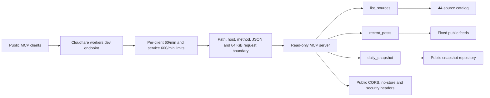

# AI Workflow Feed MCP

A read-only, remote Model Context Protocol (MCP) server for discovering articles about AI-assisted software development and agent workflows. It returns source metadata and links to the original articles, so an MCP-capable AI client can retrieve and review the originals before summarizing them.

**Remote endpoint:** `https://ai-workflow-feed-mcp.zoelinebot2026.workers.dev/mcp`

**MCP Registry:** [`io.github.quietbranch88/ai-workflow-feed`](https://registry.modelcontextprotocol.io/v0.1/servers/io.github.quietbranch88%2Fai-workflow-feed/versions/latest)

## Production overview

| Surface | Current public instance |
| --- | --- |
| Access | Public and unauthenticated; all three tools are read-only |
| Transport | Remote MCP over Streamable HTTP at `/mcp` |
| Request boundary | Both rate-limit bindings run before path, host, method, media-type, and body-policy responses; POST bodies are capped at 64 KiB |
| Rate limits | Approximate per Cloudflare location: 60 requests/minute per pseudonymized client address and 600 requests/minute for the service |
| Managed WAF | Not attached to the `workers.dev` hostname; an owned custom domain is required for zone-level Cloudflare Managed WAF rules |
| Verified deployment | On 2026-10-31, Git commit [`334598e`](https://github.com/quietbranch88/ai-workflow-feed-mcp/commit/334598ee3cc21e408e164b93f232e2a001abe014) was deployed as Worker version `edfacf30-1aa1-4266-a0d1-4edd17dc97a3` at 100% |



The diagram describes the application boundary, not a zone-level managed WAF. Feed titles, excerpts, metadata, and linked pages remain untrusted data; clients should verify original sources before relying on a summary.

## Connect

Add the endpoint above to an MCP client that supports remote Streamable HTTP connections. The setup interface varies by client; the endpoint is not a normal webpage. Ask the connected assistant, for example:

> Find recent articles about testing AI-generated code and summarize readable originals in Traditional Chinese with links and limitations.

## What it provides

- `list_sources` lists the curated source catalog, default category, source provenance, `recent_posts_status`, and whether a daily snapshot is configured. Configuration does not guarantee that the latest collection succeeded.
- `daily_snapshot` reads a scheduled snapshot from a separate public data repository, reporting retrieval times, failures, stale results and truncation. It currently covers eight sources that may be missing or size-limited in live feeds.
- `recent_posts` retrieves bounded batches by category (`ai_development` or `agent_flow`) or selected source IDs. For category queries, follow `next_source_offset` until it is `null`. Each batch defaults to 2 sources and is limited to 3. Errors and unavailable sources are reported.
- Source entries are grouped by their **default source category**, not classified article by article. Each entry contains a title, date, URL, and, where provided by the source, a short excerpt. The MCP does not read full articles or invoke a model.
- The catalog currently has 44 entries: 35 configured for automatic retrieval, 8 marked manual-only, and one known size-limited source. Availability can change. For `recent_posts`, TikTok Developers is manual-only and the GitHub AI feed exceeds the current 1 MB limit; both are separately included in `daily_snapshot`. Feed data may omit articles or be delayed. Long feeds are truncated at 100 items per source and results indicate truncation.
- A client may summarize or translate in a chosen language using its own capabilities. No server-side translation or language filtering is supplied.

## Privacy and operating limits

The server queries fixed public sources and a fixed public snapshot; it does not accept arbitrary feed URLs, store per-user tracking preferences, publish posts, or send notifications. Client queries and network metadata are handled by the hosting platform and upstream services; consult their respective policies. Feed content is untrusted data and may contain errors or adversarial instructions. Read the original source before relying on a summary.

The public instance uses a shared free-tier hosting account. Its Worker request boundary allows only MCP transport methods, requires JSON POST bodies, rejects request bodies over 64 KiB, and applies security response headers. It uses approximate per-location limits of 60 requests per minute for a pseudonymized client address and 600 requests per minute for the service. Cloudflare's Worker rate-limit counters are not a strict global cost ceiling, and availability is not guaranteed. The `workers.dev` endpoint does not have a customer zone to which zone-level Cloudflare Managed WAF rules can be attached; moving to a custom domain is required before deploying those managed rules. A personal daily summary configured separately by the maintainer is not a feature of this MCP server.

## Development

Requires Node.js and npm. From this directory:

```sh
npm ci
npm test
npm run build
npm run dev -- --ip 127.0.0.1 --port 18787 --var ALLOWED_HOST:localhost
```

In another terminal, run a read-only smoke test against the local worker:

```sh
node scripts/mcp-smoke.mjs cablate simon
```

The smoke test accesses public websites. A failure can reflect upstream access or network conditions, not necessarily an implementation defect. The included `wrangler.jsonc` contains **placeholder Worker name and hostname** for your own deployment; configure an exact hostname and unique rate-limit namespaces in your own account before deploying. See [Cloudflare's remote MCP guide](https://developers.cloudflare.com/agents/model-context-protocol/guides/remote-mcp-server/) and [Worker rate-limit binding documentation](https://developers.cloudflare.com/workers/runtime-apis/bindings/rate-limit/).

## Current evidence and limits

On 2026-10-31 the hosted Worker was tested with an official MCP client: initialization, tool listing, representative category batches, invalid-input handling, and real queries to iT 邦幫忙, TheAI, codecentric, n8n, Meituan, Qdrant, and Alibaba succeeded. Meituan dates are inferred from its article URLs when its feed supplies no date; they are explicitly marked as unverified and time filtering is conservative. One later `daily_snapshot` check reported seven successful sources and a Haystack HTTP 308 collection failure. After the rate-limit coverage fix was deployed, a newer official client check reported all eight snapshot sources healthy with no partial failure. These are time-bounded observations, not guarantees of availability or complete coverage.

## 繁體中文

這個 MCP 協助 AI 助手查詢 AI 開發與 Agent Flow 相關文章，並保留來源與原文連結。請在支援遠端 MCP 的 AI 工具中新增上面的網址，再要求助手「用繁體中文整理最近的 AI 開發文章」。原文可能無法讀取，來源清單也不保證完整；TikTok 公司部落格可透過 daily_snapshot 查詢，但 recent_posts 不會即時抓取它。


## Daily public snapshot

The read-only `daily_snapshot` tool retrieves the latest snapshot from the [separate public data repository](https://github.com/quietbranch88/ai-workflow-feed-snapshots). Its collector is configured to run daily at 00:00 UTC using GitHub Actions, subject to schedule delays and failures. The eight configured sources are GitHub AI and ML, Uber Engineering, TikTok Developers, Codesai, Claude Community, Langfuse, Haystack and Jina AI. Uber uses an **unofficial third-party feed**, which may omit or delay posts; the others use public site directories. Source categories are defaults, not article-level classification.

The response reports each source's last successful fetch, latest attempt, status, and whether stored entries were truncated or are stale. A failed collection can return the last successfully collected entries with an error. The reader isolates invalid or missing sources and ignores unknown sources without trusting their contents; malformed documents and unsupported schema versions fail closed. Unversioned snapshots remain compatible. The snapshot contains titles, dates, original links and possible excerpts, not full articles or AI summaries. No claim is made that every source is complete or that scheduled runs always succeed. This repository contains the collector and reader code; the data repository's reviewed workflow runs a pinned revision of that collector.
